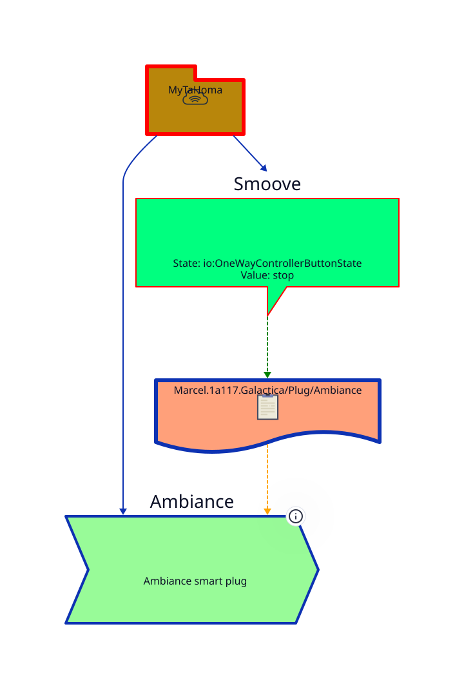

While a **Smoove remote control** can typically be used to trigger scenarios, its '*My*' button remains unused.  
Thanks to this configuration, Marcel overcomes this limitation:

- MyTaHoma listens for the corresponding event (io:OneWayControllerButtonState / stop).
- The 'Ambiance' command receives the relevant message and forwards it to an On/Off smart plug to turn on the lamp for 30 seconds.
